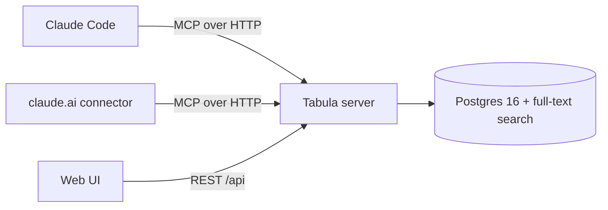

# Tabula

**A small, self-hosted memory for AI agents, served over MCP.**

An AI coding agent starts every session with an empty head. What it learned yesterday — that the tests must run through a particular script, that a library mangles Slovak text, that a decision was already made and why — is gone, unless someone wrote it down where the agent will look. Claude Code's local memory helps, but it lives on one machine and in one client. Move to another computer, or open claude.ai, and the agent starts from zero again.

Tabula (Latin for *writing tablet*) is that place to write things down. It is one small server with a Postgres database that any MCP client can read from and write to: Claude Code on several machines, claude.ai, or any other agent that speaks the [Model Context Protocol](https://modelcontextprotocol.io). A web UI lets a human review, edit and prune what the agents wrote.

It is deliberately modest. Tabula stores **rules, decisions, facts and gotchas** — short, durable knowledge that is not visible in the code. It is not a document search engine, not a chat history, and not a replacement for `CLAUDE.md` or the code itself.

## How it works

### Three kinds of records

| | Written by | Agents can | Shape |
|---|---|---|---|
| **Memory** | agents (and the human) | create, supersede, deprecate | `kind` + one-line `title` (≤ 120 chars) + `body` (≤ 2 000 chars) + tags |
| **Note** | the human only | read | longer Markdown with a short summary; can be *pinned* |
| **Thought** | the human, and agents on request | create, edit, append | Markdown notebook entry (≤ 50 000 chars) + tags; **no project**, never in `recall` |

Memories and notes belong to a project and feed the recall digest. **Thoughts** are a personal notebook next to them: ideas, summaries of a chat worth keeping, things to come back to. Say *"save this to Tabula"* in a claude.ai chat and the agent writes a thought; say *"add the conclusion to that thought"* and it appends to it. Every change to a thought's text keeps the previous version (the last 50), so an agent's edit can always be undone in the UI, and edits use optimistic locking (`expected_version`) so an agent never silently overwrites what you are typing.

A memory has one of four kinds, and the kind decides how prominently it is shown to the agent:

- **rule** — how things are done (*"Run Nx in another directory as `pnpm -C <dir> exec nx`"*)
- **gotcha** — a trap someone already fell into (*"Postgres `english` text search mangles Slovak words; use `simple`"*)
- **decision** — what was decided and why (*"Drizzle over Prisma, because…"*)
- **fact** — the state of the world that the code doesn't show (*"Production runs on a single VPS, not in a managed cloud"*)

Records belong to a **project** (a flat slug such as `music-creator`) or to the reserved project **`global`**, whose records are included everywhere. A memory is never edited by an agent in place: a newer one *supersedes* it (the old one is deprecated in the same transaction, so the history stays visible), or the agent *deprecates* it with a reason. Human-written records are read-only for agents.

### The recall digest

At the start of a session the agent calls `recall` once and gets a plain-text digest of the project plus `global`:

```text
# Tabula · music-creator (+ global) · 2026-10-22

## Rules (always follow)
- [g] Start jobs that must outlive the session detached, not in Bash background mode (#00b7)
  Bash background mode belongs to the session and dies with it. On Windows start a script
  detached with Start-Process, logging to a file; check it with Get-Process and the log tail.
- When something does not fit the plan, stop and ask the author — never work around it (#f950)
  …

## Gotchas
- Run Nx in another dir as `pnpm -C <dir> exec nx` (#7ca4)
  …

## Decisions (title only — `get` for the why)
- Drizzle over Prisma (#e5f2)

## Facts
- Suno caps downloads at about 20 a month — at most two downloads per song (#258c)

## Notes (human-authored, read-only — `get` for full text)
- #1c2d Architecture overview — module boundaries and event contracts (2 100 words)
```

The digest is built to change what the agent *does* while leaving room in its context for the actual work:

- **Fixed order by impact:** rules → gotchas → decisions → facts → notes → pinned notes. Rules and gotchas come in full; decisions, facts and notes as one-line titles with a short id the agent can pass to `get`.
- **Hard budget of 1 500 tokens** (estimated as characters / 4). Over budget, the server trims in a fixed order until it fits: decisions collapse into *"N decisions omitted — use search"*, rule and then gotcha bodies shrink to their first sentence, and finally facts and notes collapse into counts too. Pinned notes are never trimmed; the UI shows their size before you pin one.
- **Plain text, not JSON.** The agent reads the digest rather than parsing it, and JSON would cost 30–40 % more tokens in quotes and keys.
- **No relevance guessing.** At the start of a session the agent doesn't yet know what it will work on, so relevance is curated by a human through `kind` and pinning, not by a heuristic.

### MCP tools

| Tool | What it does |
|---|---|
| `recall(project)` | The digest above. Called once at the start of a session. |
| `search(query, project?, kind?, include_deprecated?, limit?)` | Full-text search over memories and notes (Postgres `tsvector`, title weighted above tags above body). |
| `get(id)` | One record in full; accepts the short `#xxxx` id from the digest. |
| `remember(project, kind, title, body, tags?, supersedes_id?)` | Stores a memory. Rejects unknown projects, over-long fields and empty bodies with a reason the agent can act on. |
| `deprecate(id, reason)` | Marks a memory as no longer valid. Idempotent; refuses human-written records. |
| `list_projects()` | Slugs, descriptions and record counts. |
| `setup_project(id, name?, description?)` | Onboards a project — only when the user explicitly asks (see below). |
| `save_thought(title, body, tags?)` | Saves a new thought to the personal notebook — only when the user asks. |
| `update_thought(id, title?, body? \| append?, tags?, expected_version?)` | Rewrites or appends to a thought; the previous version is kept. |
| `find_thoughts(query?, tag?, limit?)` | Newest thoughts, or a prefix search over them; returns ids and versions. |

The tool descriptions are part of the design, not an implementation detail: they are the only thing an agent reads before deciding whether to write. They tell it to search before writing, to supersede instead of duplicating, to expect 0–3 records per session, and never to store secrets.

### When agents use it

Tabula is registered once per client, so it is visible in every project. To keep it out of projects that don't use it, the server sends MCP *instructions* to every client: use Tabula only in a project whose `CLAUDE.md` (or claude.ai project instructions) contains a **"Memory (Tabula)"** section naming the project, and never guess a slug.

That section is the whole per-project protocol:

```markdown
## Memory (Tabula)
Tabula (MCP server `tabula`) is a backup memory that carries knowledge to other machines and to claude.ai. It ranks last: the code and the docs in git first, then Claude Code's local memory, then Tabula. On a conflict the higher source wins and the Tabula record is fixed at the next handoff.
- This project's Tabula project is `my-project`.
- At session start call `recall` for `my-project` and follow its rules and gotchas. A record older than the code it describes is suspect — check it.
- Write only at handoff: 0–3 records of what is not in git but another machine would need (mostly what local memory holds). `search` first; replace an outdated record with `remember` + `supersedes_id`, `deprecate` one that no longer holds.
- Never store secrets, task progress, TODOs or anything already in git.
```

You don't write it by hand. In a new project, tell the agent *"use Tabula in this project"*: it calls `setup_project` with the folder name as the slug, which creates the project if needed and returns the section; the agent puts it into `CLAUDE.md` and calls `recall`. Templates for both clients are in [`templates/`](templates/).

The section encodes how Tabula is meant to be used: as a **backup memory** that ranks below the code and the agent's own local memory, written to at the end of a session (a "handoff") rather than continuously. That keeps the volume low and the records deliberate.

### The web UI

A responsive React app with its own small UI kit (`web/src/ui`: tokens, buttons, fields, tag input, dialogs and bottom sheets, toasts, a data table that turns into cards on phones, Markdown editor), light and dark themes (follows the OS, or pick one), and an installable icon for the home screen.

- **Sidebar** — Thoughts, all memories across projects, and the projects with their record counts. On phones it is a drawer.
- **Thoughts** — card grid with search, tag chips, sort, author filter (you / AI), archive and pinning. The editor has Write / Split / Preview modes, Ctrl/⌘ S, a warning when an agent changed the thought while you were typing, and a version history with restore.
- **Memories** — a server-side paginated, sortable table (project, kind, author, status, prefix search). Edit, deprecate with a reason, replace with a new version (supersede), delete, follow the supersede chain.
- **Project** — tabs for its memories, notes (Markdown editor; pin with a token-budget warning), the **recall preview** (the exact digest with a budget meter) and **setup** (name, description, the CLAUDE.md section and client commands to copy).
- **Search** (Ctrl/⌘ K) — memories, notes and thoughts at once; words match as prefixes.

Lists refresh when the window regains focus, so what an agent wrote meanwhile shows up. The UI asks once for the bearer token and keeps it in `localStorage`.

## Architecture



One Node.js process serves everything: the MCP endpoint (`/mcp`), the REST API for the UI (`/api`), the static UI build and `/healthz`.

- **Node 22, TypeScript, Fastify 5.** Domain logic lives in `src/domain` and is shared by the MCP tools and the REST API; `src/agent` adds the rules that apply only to agents (source tagging, read-only human records).
- **MCP TypeScript SDK v2**, Streamable HTTP in **stateless** mode: every request gets a fresh server instance, so the process holds no session state and restarts are invisible to clients.
- **Postgres 16 with Drizzle ORM.** Search uses a generated, weighted `tsvector` column with a GIN index and the `simple` configuration, because records mix Slovak and English and language-specific stemming would mangle one of them. No embeddings: the records are short and most reads go through `recall`, not search.
- **React + Vite** UI, built into static files served by the same process.
- **Migrations run automatically** on startup.

## Getting started

### Run it with Docker Compose

```bash
git clone https://github.com/carnaby/tabula-mcp.git && cd tabula-mcp
cat > .env <<EOF
POSTGRES_PASSWORD=$(openssl rand -hex 32)
TABULA_TOKEN=$(openssl rand -hex 32)
TABULA_CONNECTOR_SECRET=$(openssl rand -hex 32)
EOF
docker compose up -d --build
curl -fsS http://localhost:3000/healthz   # {"ok":true}
```

Open `http://localhost:3000`, paste `TABULA_TOKEN`, and create your first project — or let an agent create it with `setup_project`.

CI also publishes a ready-made image, `ghcr.io/carnaby/tabula:latest` (plus a `sha-<commit>` tag per build). [`deploy/`](deploy/) holds an example production stack that pulls it and a daily `pg_dump` backup script.

For anything beyond localhost, put Tabula behind a reverse proxy that terminates TLS and bind the container to loopback: the bearer token travels in a header, and it unlocks the whole memory.

### Connect Claude Code

```bash
claude mcp add tabula --scope user --transport http https://tabula.example.com/mcp \
  --header "Authorization: Bearer <TABULA_TOKEN>" \
  --header "X-Tabula-Agent: claude-code"
```

`X-Tabula-Agent` labels the records this client writes, so the UI shows which agent wrote what. Check with `claude mcp get tabula`.

### Connect claude.ai

In **Settings → Connectors → Add custom connector**, use

```text
https://tabula.example.com/mcp/<TABULA_CONNECTOR_SECRET>
```

with no authentication. Custom connectors in claude.ai can't always send a static `Authorization` header, so when `TABULA_CONNECTOR_SECRET` is set, Tabula also accepts the secret as a path segment. Treat that URL as a password. Records written this way are labelled `claude-ai`.

Then paste [`templates/claude-ai-project-instructions.md`](templates/claude-ai-project-instructions.md) into the instructions of a claude.ai project, with your project slug.

### Other MCP clients

Any client that speaks Streamable HTTP with the classic `initialize` handshake (protocol `2025-11-25`) works: point it at `/mcp` with the bearer header.

## Configuration

| Variable | Required | Default | Meaning |
|---|---|---|---|
| `DATABASE_URL` | yes | — | Postgres connection string (set by Compose) |
| `TABULA_TOKEN` | yes | — | Bearer token for MCP and the UI, at least 32 characters |
| `TABULA_CONNECTOR_SECRET` | no | — | Enables `/mcp/<secret>` for clients that can't send headers, at least 32 characters |
| `PORT` | no | `3000` | Port the server listens on |
| `HOST` | no | `0.0.0.0` | Interface to bind |
| `WEB_DIST` | no | `web/dist` | Path to the UI build |
| `LOG_LEVEL` | no | `info` | `debug`, `info`, `warn` or `error` |
| `POSTGRES_PASSWORD` | Compose | — | Database password used by `docker-compose.yml` |
| `TABULA_PORT` | Compose | `3000` | Host port published by `docker-compose.yml` |

## Development

```bash
pnpm install
pnpm db:dev                 # Postgres 16 in Docker (container tabula-dev-db, port 5432)
cp .env.example .env        # then set TABULA_TOKEN
pnpm dev                    # server with reload on PORT (default 3000)
pnpm dev:web                # UI on http://localhost:5173, proxies /api to TABULA_API (default http://localhost:3000)
```

A `502 Bad Gateway` on `/api` in the browser means the server isn't running — usually because the database isn't.

```bash
pnpm typecheck              # server and UI
pnpm test                   # Vitest; starts a throwaway Postgres via Testcontainers (needs Docker)
TEST_DATABASE_URL=postgres://… pnpm test   # or use an existing throwaway database (it is wiped)
```

The tests cover the domain rules, the digest builder, the REST API and the MCP endpoint end to end through a real MCP client.

### Layout

```text
src/
  domain/      records, validation, search, digest builder, token estimate
  agent/       what agents may do (source tagging, read-only human records)
  mcp/         MCP server, tool descriptions, server instructions, CLAUDE.md section
  http/        Fastify app, REST API, bearer auth, static UI
  db/          Drizzle schema, client, migrations runner
drizzle/       SQL migrations (generated search column, GIN indexes, the global project)
web/           React UI (web/src/ui is the UI kit)
templates/     protocol snippets for CLAUDE.md, claude.ai and a SessionStart hook
deploy/        example production stack and backup script
```

## Security

- **Never store secrets in Tabula** — not as a fact, not in a note. The tool descriptions say so, and it is the reason a single shared token is acceptable for a personal deployment.
- One bearer token (and the optional connector secret) unlocks everything. Tokens are compared in constant time, and the connector secret is kept out of request logs.
- Unexpected errors are logged on the server and returned to clients as a generic message, without internals.
- Input is validated at the boundary: length limits, slug format, and NUL characters rejected before they reach Postgres.

## Status and roadmap

Tabula is a working MVP in daily personal use with Claude Code and claude.ai. The next steps depend on what real use shows, not on a feature list:

- prefix matching and `unaccent` for search, if `search` keeps missing records that are there;
- a soft duplicate warning on `remember`, if duplicates survive better tool descriptions;
- Markdown import/export for git-friendly backups;
- a per-session log of `recall`/`remember` calls, to see whether agents follow the protocol;
- OAuth instead of a static token, once there is more than one user.

Deliberately out of scope: embeddings and RAG, automatic expiry, automatic contradiction detection, and inheritance between projects.

## License

MIT — see [LICENSE](LICENSE).
