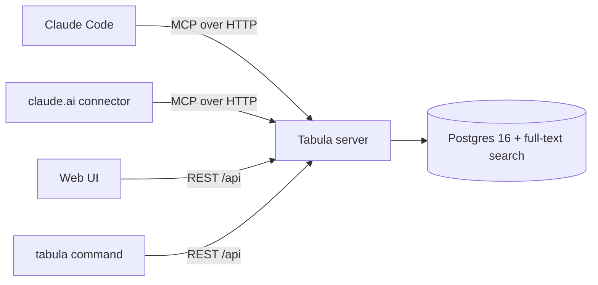

# Tabula

**A small, self-hosted memory for AI agents, served over MCP.**

An AI coding agent starts every session with an empty head. Most of what it needs is in the repository: the code, `CLAUDE.md`, the docs in git. Some of it is not. Handoff notes that say where the last session stopped, specs and plans that must stay out of a public repository, the progress log of a running plan — they are gitignored on purpose, so a fresh clone or another computer doesn't have them, and claude.ai never sees them.

Tabula (Latin for *writing tablet*) keeps exactly that. It is one small server with a Postgres database, an MCP endpoint for agents ([Model Context Protocol](https://modelcontextprotocol.io)), a REST API and a web UI:

- **Project files** — a repository's untracked files (handoff state, private specs and plans), mirrored by a dependency-free `tabula` command. A session-start hook restores them in a fresh clone, `tabula push` at handoff saves them, and claude.ai reads them through MCP.
- **Global rules** — the few rules that apply to every project. You write them in the UI; agents add one only when you explicitly ask.
- **Notes** — your own notebook. Agents read it only when you mention your notes.
- **Thoughts** — a notebook of things worth keeping from chats: say *"save this to Tabula"* in claude.ai and it lands there.

It is deliberately modest: no embeddings, no automatic memory, and no second copy of what git or the agent's own local memory already hold.

## How it works

### What it stores

| | Written by | Agents can | Shape |
|---|---|---|---|
| **Project file** | the `tabula` command, from the repository | list, read, search | UTF-8 text ≤ 1 MiB at a repository-relative path; the last 20 versions are kept; deleting is reversible |
| **Global rule** | you; agents only on request | read; add or retire one on explicit request | `kind` (rule, gotcha, fact, decision) + one-line title + body ≤ 2 000 characters |
| **Note** | you | read, when you mention your notes | Markdown with tags; pinned notes stay on top |
| **Thought** | you, and agents on request | create, edit, append | Markdown ≤ 50 000 characters with tags; every change keeps the previous version (the last 50) |

Project files and global rules feed the `recall` digest. Notes and Thoughts never do.

### The `tabula` command

`tabula` is a single ES module (`cli/tabula.mjs`) without dependencies; Node 22 or newer runs it on Windows, macOS and Linux. The server hands it out at `/cli/tabula.mjs`:

```bash
# macOS / Linux
mkdir -p ~/.tabula && curl -fsSL https://tabula.example.com/cli/tabula.mjs -o ~/.tabula/tabula.mjs
node ~/.tabula/tabula.mjs install                  # shims in ~/.tabula/bin; add that folder to PATH as printed
node ~/.tabula/tabula.mjs login https://tabula.example.com   # asks for the token, saves ~/.tabula/config.json
```

```powershell
# Windows (PowerShell)
New-Item -ItemType Directory -Force "$HOME\.tabula" | Out-Null
Invoke-WebRequest https://tabula.example.com/cli/tabula.mjs -OutFile "$HOME\.tabula\tabula.mjs"
node "$HOME\.tabula\tabula.mjs" install
node "$HOME\.tabula\tabula.mjs" login https://tabula.example.com
```

Once `~/.tabula/bin` is on your `PATH`, plain `tabula …` works.

A repository opts in with a `.tabula.json` in its root, committed:

```json
{
  "sync": ["docs/**", ".superpowers/sdd/*/progress.md"],
  "state": ["docs/handoff/*.md"]
}
```

- `project` (optional) names the Tabula project; by default it is the name of the working-tree folder, so a git worktree for a side series syncs into its own project with the same file.
- `sync` lists glob patterns (`**`, `*`, `?`). Only files git does **not** track are candidates — untracked and ignored ones, never `node_modules/` or `.git/`. `.env` and `.env.*` (any letter case) are refused even when a pattern matches them, so keep the patterns explicit; binary files, invalid UTF-8 and files over 1 MiB are skipped with a warning.
- `state` lists the files that form the current project state (default: `docs/handoff/*.md` at any depth). `recall` includes their content.

| Command | What it does |
|---|---|
| `tabula status` | new, changed, newer on the server, conflicts, missing here, deleted on the server |
| `tabula push [--force]` | uploads new and changed files; never deletes; warns before uploading more than 100 new files |
| `tabula pull [--force]` | writes missing files and updates unchanged copies, state files first; a file that cannot be written is reported and skipped; never deletes local files |
| `tabula rm <path>` | deletes a file on the server (restorable in the UI) |
| `tabula pull --hook` | for the SessionStart hook: silent without `.tabula.json` or a login, at most 5 seconds (when time runs out it keeps what it restored and says how many files are missing), always exit 0 |
| `tabula login <url>` · `install` · `update` | credentials (or `TABULA_URL` / `TABULA_TOKEN`), PATH shims and the hook snippet, self-update |

Each clone keeps the hash it last synced for every file in `<git-dir>/tabula-sync.json` (per worktree, never committed). The server accepts a change only if it is based on the server's current version, so two machines editing the same file produce a **conflict** instead of a silent overwrite: merge by hand, or take one side with `--force`. Exit codes: 0 OK, 1 error, 2 finished with conflicts.

To restore the files at the start of every Claude Code session, add the hook from [`templates/session-start-hook.json`](templates/session-start-hook.json) to `~/.claude/settings.json`:

```json
{ "hooks": { "SessionStart": [ { "hooks": [ { "type": "command", "command": "node ~/.tabula/tabula.mjs pull --hook", "timeout": 10 } ] } ] } }
```

On Windows use the absolute path that `tabula install` prints, e.g. `node "C:/Users/<you>/.tabula/tabula.mjs" pull --hook`.

### The recall digest

At the start of a session the agent calls `recall` once and gets plain text:

```text
# Tabula · music-creator · 2026-10-26

## Global rules (always follow)
- Start jobs that must outlive the session detached, not in Bash background mode (#00b7)
  Bash background mode belongs to the session and dies with it. …

## Global gotchas
- Python on Windows writes CRLF unless told otherwise (#3e1a)
  …

## Project state
### docs/handoff/2026-10-26-state.md (2026-10-26)
# Where we are
…

## Files (14) — `read_file` for the content
- docs/handoff/2026-10-26-state.md — 2026-10-26, 3.1 KB (state)
- docs/superpowers/specs/2026-10-20-mixer-design.md — 2026-10-20, 18.4 KB
…
```

- **Fixed order:** global rules → global gotchas → global facts and decisions (titles only) → project state → the file list.
- **Budget of 3 000 tokens** (estimated as characters / 4). The global rules and the file list come first; the state gets the room they leave and is cut at a line break with a pointer to `read_file`. If the rules and the list alone are too long, the list collapses into a count, then facts collapse, then gotcha and rule bodies shrink to their first sentence.
- **`include_state`:** Claude Code passes `false` — the hook already restored the files on disk. claude.ai gets the state in the digest.
- **Plain text, not JSON.** The agent reads the digest rather than parsing it, and JSON would cost 30–40 % more tokens.

### MCP tools

| Tool | What it does |
|---|---|
| `recall(project, include_state?)` | The digest above. Called once at the start of a session. |
| `list_files(project)` / `read_file(project, path, offset?)` | The project's synced files; long files come in parts of 100 000 characters. |
| `search(query, project?, kind?, include_deprecated?, limit?)` | Full-text search over the global rules and the project files (Postgres `tsvector`, `simple` configuration). |
| `get(id)` | One rule, note or thought in full; accepts the short `#xxxx` id from the digest. |
| `remember(project="global", kind, title, body, tags?, supersedes_id?)` | Adds a global rule — only when the user explicitly asks. Any other project is refused with the reason. |
| `deprecate(id, reason)` | Retires a global rule the agent wrote. Refuses human-written records. |
| `find_notes(query?, tag?, limit?)` | Reads your Notes — only when you mention them. |
| `save_thought` · `update_thought` · `find_thoughts` | The Thoughts notebook, on request; edits use `expected_version` and keep the previous version. |
| `list_projects()` · `setup_project(id, name?, description?)` | Projects with file counts; onboarding on explicit request (returns the CLAUDE.md section, a `.tabula.json` and the next step: `tabula status` before the first push). |

The tool descriptions are part of the design: they are what an agent reads before deciding whether to call a tool, and they say when *not* to.

### When agents use it

Tabula is registered once per client, so it is visible in every project. The server's MCP *instructions* tell every client to use it for a project only when that project's `CLAUDE.md` (or claude.ai project instructions) contains a **"Memory (Tabula)"** section naming the project, never to guess a slug, and never to write project memories. Thoughts and Notes work anywhere, on request.

The section is the whole per-project protocol:

```markdown
## Memory (Tabula)
Tabula keeps this project's files that are not in git (handoff state, private specs and plans) and the global rules that apply to every project.
- This project's Tabula project is `my-project`; `.tabula.json` says which untracked files are synced.
- At session start call `recall` for `my-project` with `include_state: false` and follow the global rules. The project state is on disk (restored by the SessionStart hook).
- At handoff run `tabula push` after writing the state file.
- Never write project memories. Add a global rule only when the user explicitly asks.
```

You don't write it by hand: tell the agent *"use Tabula in this project"* and it calls `setup_project` with the folder name as the slug, puts the section into `CLAUDE.md` and the suggested `.tabula.json` into the repository root. Run `tabula status` before the first `tabula push`: it lists every file the push would upload. For claude.ai projects use [`templates/claude-ai-project-instructions.md`](templates/claude-ai-project-instructions.md).

### The web UI

A responsive React app with its own small UI kit (`web/src/ui`), light and dark themes, and an installable icon for the home screen.

- **Sidebar** — Thoughts, Notes, Global, and the projects with their file counts. On phones it is a drawer.
- **Thoughts** and **Notes** — card grids with search, tag chips, sort and pinning; a Markdown editor with Write / Split / Preview and Ctrl/⌘ S. Thoughts also keep a version history and warn when an agent changed the text while you were typing.
- **Global** — the rules table (kind, author, status, prefix search; edit, retire, supersede) and the recall preview.
- **Project** — **State** (the state files rendered as Markdown), **Files** (list, preview, the last 20 versions with restore, delete and restore), **Recall preview** (the exact digest with a budget meter) and **Setup** (the CLAUDE.md section, a `.tabula.json`, the install commands and the hook).
- **Search** (Ctrl/⌘ K) — global rules, project files, notes and thoughts at once; words match as prefixes.

**Install it as an app.** Tabula is a PWA: in Chrome or Edge use *Install app* in the sidebar (or the install icon in the address bar); on iPhone use Share → *Add to Home Screen*. A service worker caches only the app shell and the hashed build assets — `/api` and `/mcp` always go to the network, so data is never stale and the token never ends up in a cache. Installation needs HTTPS (or `localhost`).

Lists refresh when the window regains focus, so what an agent or another machine wrote meanwhile shows up. The UI asks once for the bearer token and keeps it in `localStorage`.

## Architecture



One Node.js process serves everything: the MCP endpoint (`/mcp`), the REST API for the UI and the CLI (`/api`), the CLI download (`/cli/tabula.mjs`, `/cli/version`), the static UI build and `/healthz`.

- **Node 22, TypeScript, Fastify 5.** Domain logic (including project files with optimistic locking) lives in `src/domain` and is shared by the MCP tools and the REST API; `src/agent` adds the rules that apply only to agents (source tagging, read-only human records).
- **MCP TypeScript SDK v2**, Streamable HTTP in **stateless** mode: every request gets a fresh server instance, so the process holds no session state and restarts are invisible to clients.
- **Postgres 16 with Drizzle ORM.** Search uses a generated, weighted `tsvector` column with a GIN index and the `simple` configuration, because records mix Slovak and English and language-specific stemming would mangle one of them. No embeddings: the records are short and most reads go through `recall`, not search.
- **React + Vite** UI, built into static files served by the same process.
- **Migrations run automatically** on startup.

## Getting started

### Run it with Docker Compose

```bash
git clone https://github.com/carnaby/tabula-mcp.git && cd tabula-mcp
cat > .env <<EOF
POSTGRES_PASSWORD=$(openssl rand -hex 32)
TABULA_TOKEN=$(openssl rand -hex 32)
TABULA_CONNECTOR_SECRET=$(openssl rand -hex 32)
EOF
docker compose up -d --build
curl -fsS http://localhost:3000/healthz   # {"ok":true}
```

Open `http://localhost:3000`, paste `TABULA_TOKEN`, and create your first project — or let an agent create it with `setup_project`.

CI also publishes a ready-made image, `ghcr.io/carnaby/tabula:latest` (plus a `sha-<commit>` tag per build). [`deploy/`](deploy/) holds an example production stack that pulls it and a daily `pg_dump` backup script.

For anything beyond localhost, put Tabula behind a reverse proxy that terminates TLS and bind the container to loopback: the bearer token travels in a header, and it unlocks everything Tabula holds.

### Connect Claude Code

```bash
claude mcp add tabula --scope user --transport http https://tabula.example.com/mcp \
  --header "Authorization: Bearer <TABULA_TOKEN>" \
  --header "X-Tabula-Agent: claude-code"
```

`X-Tabula-Agent` labels what this client writes, so the UI shows which agent wrote what. Check with `claude mcp get tabula`.

### Connect claude.ai

In **Settings → Connectors → Add custom connector**, use

```text
https://tabula.example.com/mcp/<TABULA_CONNECTOR_SECRET>
```

with no authentication. Custom connectors in claude.ai can't always send a static `Authorization` header, so when `TABULA_CONNECTOR_SECRET` is set, Tabula also accepts the secret as a path segment. Treat that URL as a password. Records written this way are labelled `claude-ai`.

Then paste [`templates/claude-ai-project-instructions.md`](templates/claude-ai-project-instructions.md) into the instructions of a claude.ai project, with your project slug.

### Other MCP clients

Any client that speaks Streamable HTTP with the classic `initialize` handshake (protocol `2025-11-25`) works: point it at `/mcp` with the bearer header.

## Configuration

| Variable | Required | Default | Meaning |
|---|---|---|---|
| `DATABASE_URL` | yes | — | Postgres connection string (set by Compose) |
| `TABULA_TOKEN` | yes | — | Bearer token for MCP and the UI, at least 32 characters |
| `TABULA_CONNECTOR_SECRET` | no | — | Enables `/mcp/<secret>` for clients that can't send headers, at least 32 characters |
| `PORT` | no | `3000` | Port the server listens on |
| `HOST` | no | `0.0.0.0` | Interface to bind |
| `WEB_DIST` | no | `web/dist` | Path to the UI build |
| `LOG_LEVEL` | no | `info` | `debug`, `info`, `warn` or `error` |
| `POSTGRES_PASSWORD` | Compose | — | Database password used by `docker-compose.yml` |
| `TABULA_PORT` | Compose | `3000` | Host port published by `docker-compose.yml` |

## Development

```bash
pnpm install
pnpm db:dev                 # Postgres 16 in Docker (container tabula-dev-db, port 5432)
cp .env.example .env        # then set TABULA_TOKEN
pnpm dev                    # server with reload on PORT (default 3000)
pnpm dev:web                # UI on http://localhost:5173, proxies /api to TABULA_API (default http://localhost:3000)
```

A `502 Bad Gateway` on `/api` in the browser means the server isn't running — usually because the database isn't.

```bash
pnpm typecheck              # server and UI
pnpm test                   # Vitest; starts a throwaway Postgres via Testcontainers (needs Docker)
TEST_DATABASE_URL=postgres://… pnpm test   # or use an existing throwaway database (it is wiped; the database name must contain "test", e.g. tabula_test, and must differ from DATABASE_URL)
```

The tests cover the domain rules, the digest builder, the REST API, the MCP endpoint through a real MCP client, and the `tabula` command end to end against a real server and temporary git repositories (git must be installed).

### Layout

```text
src/
  domain/       records, validation, search, digest builder, token estimate
  agent/        what agents may do (source tagging, read-only human records)
  mcp/          MCP server, tool descriptions, server instructions, CLAUDE.md section
  http/         Fastify app, REST API, bearer auth, static UI
  db/           Drizzle schema, client, migrations runner
  maintenance/  one-off data migrations run inside the container
cli/            the tabula command (one dependency-free file, served at /cli/tabula.mjs)
drizzle/        SQL migrations (generated search column, GIN indexes, the global project)
web/            React UI (web/src/ui is the UI kit)
templates/      protocol snippets for CLAUDE.md, claude.ai and the SessionStart hook
deploy/         example production stack and backup script
test/           Vitest: unit, database, HTTP/MCP and end-to-end CLI tests
```

## Security

- **Never store secrets in Tabula** — not in a rule, a note, a thought or a synced file. The tool descriptions say so, and it is the reason a single shared token is acceptable for a personal deployment.
- **Synced files are the most likely way a secret reaches Tabula.** A `sync` pattern uploads every untracked file it matches, and untracked files are exactly where local credentials live. `.env` and `.env.*` (in any folder and any letter case) are always refused, but nothing else is guessed: keep the patterns explicit (`docs/**`, not `**`), run `tabula status` before the first `tabula push`, and treat a secret that was uploaded by mistake as leaked: `tabula rm` only hides the file (it and its previous versions stay in the database, restorable in the UI), so rotate the secret.
- One bearer token (and the optional connector secret) unlocks all projects, rules, notes and thoughts. Tokens are compared in constant time, and the connector secret is kept out of request logs.
- Unexpected errors are logged on the server and returned to clients as a generic message, without internals.
- The `tabula` command never uploads `.env` or `.env.*` files and the server refuses them too; paths are validated on both sides (relative, no `..`, no `.git`), and paths that differ only in letter case are never synced, so one cannot overwrite the other on Windows or macOS.
- `/cli/tabula.mjs` and `/cli/version` are public: they serve the CLI from this repository and no data.
- Input is validated at the boundary: length limits, slug format, and NUL characters rejected before they reach Postgres.

## Status and roadmap

Tabula is in daily personal use with Claude Code and claude.ai: it keeps the files git doesn't and a handful of global rules. The next steps depend on what real use shows, not on a feature list:

- prefix matching and `unaccent` for search, if `search` keeps missing records that are there;
- Markdown import/export for git-friendly backups;
- a per-session log of `recall`/`remember` calls, to see whether agents follow the protocol;
- OAuth instead of a static token, once there is more than one user.

Deliberately out of scope: embeddings and RAG, automatic expiry, automatic contradiction detection, and inheritance between projects.

## License

MIT — see [LICENSE](LICENSE).
