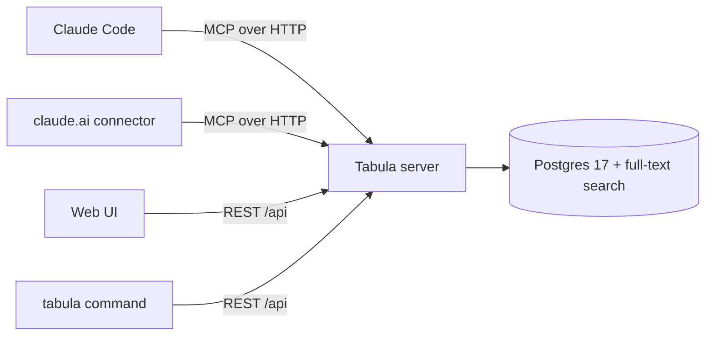

# Tabula

**A small, self-hosted memory for AI agents, served over MCP.**

**Website:** https://carnaby.github.io/tabula-mcp/ — what Tabula is, screenshots and how to start.

An AI coding agent starts every session with an empty head. Most of what it needs is in the repository: the code, `CLAUDE.md`, the docs in git. Some of it is not. Handoff notes that say where the last session stopped, specs and plans that must stay out of a public repository, the progress log of a running plan — they are gitignored on purpose, so a fresh clone or another computer doesn't have them, and claude.ai never sees them.

Tabula (Latin for *writing tablet*) keeps exactly that. It is one small server with a Postgres database, an MCP endpoint for agents ([Model Context Protocol](https://modelcontextprotocol.io)), a REST API and a web UI:

- **Project files** — a repository's untracked files (handoff state, private specs and plans), mirrored by a dependency-free `tabula` command. A session-start hook restores them in a fresh clone, `tabula push` at handoff saves them, and claude.ai reads them through MCP.
- **Global rules** — the few rules that apply to every project. You write them in the UI; agents add one only when you explicitly ask.
- **Notes** — your own notebook. Agents read it only when you mention your notes.
- **Thoughts** — a notebook of things worth keeping from chats: say *"save this to Tabula"* in claude.ai and it lands there.

It is deliberately modest: no embeddings, no automatic memory, and no second copy of what git or the agent's own local memory already hold.

## How it works

### What it stores

| | Written by | Agents can | Shape |
|---|---|---|---|
| **Project file** | the `tabula` command, from the repository; agents without it (Claude Code on the web, claude.ai) with `write_file` | list, read, search; write and delete paths the project's `sync` patterns allow | UTF-8 text ≤ 1 MiB at a repository-relative path; the last 20 versions are kept; deleting is reversible |
| **Global rule** | you; agents only on request | read; add or retire one on explicit request | `kind` (rule, gotcha, fact, decision) + one-line title + body ≤ 2 000 characters |
| **Note** | you | read, when you mention your notes | Markdown with tags; pinned notes stay on top |
| **Thought** | you, and agents on request | create, edit, append | Markdown ≤ 50 000 characters with tags; every change keeps the previous version (the last 50) |

Project files and global rules feed the `recall` digest. Notes and Thoughts never do.

### The `tabula` command

`tabula` is a single ES module (`apps/cli/tabula.mjs`) without dependencies; Node 22 or newer runs it on Windows, macOS and Linux. The server hands it out at `/cli/tabula.mjs`:

```bash
# macOS / Linux
mkdir -p ~/.tabula && curl -fsSL https://tabula.example.com/cli/tabula.mjs -o ~/.tabula/tabula.mjs
node ~/.tabula/tabula.mjs install                  # shims in ~/.tabula/bin; add that folder to PATH as printed
node ~/.tabula/tabula.mjs login https://tabula.example.com   # opens the browser to approve the connection; saves ~/.tabula/config.json
```

```powershell
# Windows (PowerShell)
New-Item -ItemType Directory -Force "$HOME\.tabula" | Out-Null
Invoke-WebRequest https://tabula.example.com/cli/tabula.mjs -OutFile "$HOME\.tabula\tabula.mjs"
node "$HOME\.tabula\tabula.mjs" install
node "$HOME\.tabula\tabula.mjs" login https://tabula.example.com
```

Once `~/.tabula/bin` is on your `PATH`, plain `tabula …` works.

A repository opts in with a `.tabula.json` in its root, committed:

```json
{
  "sync": ["docs/**", ".superpowers/sdd/*/progress.md"],
  "state": ["docs/handoff/*.md"]
}
```

- `project` (optional) names the Tabula project; by default it is the name of the working-tree folder, so a git worktree for a side series syncs into its own project with the same file.
- `sync` lists glob patterns (`**`, `*`, `?`). Only files git does **not** track are candidates — untracked and ignored ones, never `node_modules/` or `.git/`. `.env` and `.env.*` (any letter case) are refused even when a pattern matches them, so keep the patterns explicit; binary files, invalid UTF-8 and files over 1 MiB are skipped with a warning.
- `state` lists the files that form the current project state (default: `docs/handoff/*.md` at any depth). `recall` includes their content.
- Every `tabula push` also sends the `sync` and `state` patterns to the server (`PUT /api/projects/<id>/sync-config`). `write_file` uses them, matched by the same code as the command, so an agent can write only paths this repository syncs. An older server without that endpoint gets a warning, and the push still succeeds. If the server rejects the patterns, the push warns and the previously stored patterns keep deciding what agents may write.

| Command | What it does |
|---|---|
| `tabula status` | new, changed, newer on the server, conflicts, missing here, deleted on the server |
| `tabula push [--force]` | uploads new and changed files; never deletes; warns before uploading more than 100 new files |
| `tabula pull [--force]` | writes missing files and updates unchanged copies, state files first; a file that cannot be written is reported and skipped; never deletes local files |
| `tabula rm <path>` | deletes a file on the server (restorable in the UI) |
| `tabula pull --hook` | for the SessionStart hook: silent without `.tabula.json` or a login, at most 5 seconds (when time runs out it keeps what it restored and says how many files are missing), always exit 0 |
| `tabula login <url>` · `install` · `update` | sign in through the browser (an app connection for `/api`, kept in `~/.tabula/config.json` and renewed by itself; `--no-browser` only prints the address to open on the same computer; `TABULA_URL` in the environment overrides the saved address), PATH shims and the hook snippet, self-update |

Each clone keeps the hash it last synced for every file in `<git-dir>/tabula-sync.json` (per worktree, never committed). The server accepts a change only if it is based on the server's current version, so two machines editing the same file produce a **conflict** instead of a silent overwrite: merge by hand, or take one side with `--force`. Exit codes: 0 OK, 1 error, 2 finished with conflicts.

To restore the files at the start of every Claude Code session, add the hook from [`apps/server/templates/session-start-hook.json`](apps/server/templates/session-start-hook.json) to `~/.claude/settings.json`:

```json
{ "hooks": { "SessionStart": [ { "hooks": [ { "type": "command", "command": "node ~/.tabula/tabula.mjs pull --hook", "timeout": 10 } ] } ] } }
```

On Windows use the absolute path that `tabula install` prints, e.g. `node "C:/Users/<you>/.tabula/tabula.mjs" pull --hook`.

### Transcription with Fornax

Voice notes, screen recordings and recordings of meetings in reports are transcribed with timestamps and speaker labels, so an agent reads "[2:41] Eva: here the button stops responding" and asks `get_frame` for exactly that moment. Tabula itself runs on small hardware without a GPU, so the work is done by [Fornax](https://github.com/carnaby/fornax-mcp), a small job queue for one GPU worker that runs on a PC with an NVIDIA GPU. Tabula uploads each recording to Fornax, follows the job and stores the transcript. Fornax keeps a job's files for 14 days; Tabula fetches the transcript as soon as the job is done.

Tabula needs three settings (see [Configuration](#configuration)):

| Variable | |
|---|---|
| `TABULA_FORNAX_URL` | address of your Fornax, e.g. `https://fornax.example.com` |
| `TABULA_FORNAX_TOKEN` | the token Fornax gave Tabula (not shown in logs, errors or the API) |
| `TABULA_FORNAX_PRIORITY` | optional: `high` (default) or `normal`, how Fornax orders Tabula's jobs against other clients'; `low` is accepted, but Fornax treats it as `normal` |

Set the URL and the token together; with only one of them the server refuses to start and says which is missing. To get the token, run `fornax-admin tokens invite <name>` in Fornax, open the link it prints and approve the client after comparing the fingerprint; the steps are in Fornax's README under [Connect a client](https://github.com/carnaby/fornax-mcp#connect-a-client).

What you see: a recording in a report shows *waiting* with Fornax's reason (for example that the worker is offline), *running* with Fornax's progress (`Transcribing… 42 %`), *done* with the transcript, or *failed* with the reason and *Try again* (a new upload and a new job). A failed upload or an unreachable Fornax is retried after 1 and after 4 minutes before the transcription fails. Run one Tabula server per database: at start the server takes back the uploads to Fornax that its previous run did not finish. The dot next to the logo in the sidebar shows the Fornax worker (see [The web UI](#the-web-ui)).

Without `TABULA_FORNAX_URL` and `TABULA_FORNAX_TOKEN` recordings are kept but not transcribed.

### The recall digest

At the start of a session the agent calls `recall` once and gets plain text:

```text
# Tabula · music-creator · 2026-10-26

## Global rules (always follow)
- Start jobs that must outlive the session detached, not in Bash background mode (#00b7)
  Bash background mode belongs to the session and dies with it. …

## Global gotchas
- Python on Windows writes CRLF unless told otherwise (#3e1a)
  …

## Project state
### docs/handoff/2026-10-26-state.md (2026-10-26)
# Where we are
…

## Files (14) — 10 newest; `read_file` for the content
docs/handoff/ — 2026-10-26-state.md (10-26, 3.1 KB, state)
docs/superpowers/ — specs/2026-10-20-mixer-design.md (10-20, 18.4 KB), plans/2026-10-20-mixer.md (10-20, 31.0 KB)
…
- 4 more — `list_files`
```

- **Fixed order:** global rules → global gotchas → global facts and decisions (titles only) → project state → the file list.
- **The file list** names the 10 newest files, one line per folder, grouped like the Files tab of the UI (the first two levels of the path; root files under `/`; `.superpowers/` last), and counts the rest for `list_files`. No references: an agent needs the paths.
- **Budget of 3 000 tokens** (estimated as characters / 4). The global rules and the file list come first; the state gets the room they leave and is cut at a line break with a pointer to `read_file`. If the rules and the list alone are too long, the list collapses into a count, then facts collapse, then gotcha and rule bodies shrink to their first sentence.
- **`include_state`:** Claude Code on a computer passes `false` — the hook already restored the files on disk. Claude Code on the web and claude.ai get the state in the digest.
- **Plain text, not JSON.** The agent reads the digest rather than parsing it, and JSON would cost 30–40 % more tokens.

### Inbox

Projects can send each other requests and reports. Each message is its own record with a status (`new`, `in_progress`, `waiting`, `done`, `rejected`) and an append-only history. The sender's project is declared by the sender and is not verified. A message you send through the [App API](#app-api) is from `author`, with `via` naming the app connection (the authenticated App API connection, so this sender is verified); the web UI shows it as *You (via klara)*. A message that is `waiting` says who it waits for in `waiting_on`: `author` is the human who owns this Tabula, `sender` is the project that sent the message.

The web UI opens a message and each reply as their exact stored text, which is what agents receive; HTML and image links in it are plain text, and a reference (`tabula:d86d86e7`) links to Search. *Show formatted* is optional: it renders the text as Markdown without images, styles or forms, an image appears as a link, and the result may leave parts of the text out. A closed message is reopened by choosing how; nothing is preselected.

An automated reader does not need the full token. Create an **Inbox token** on the Inbox page: it is bound to one project, shown once, stored only as a hash and can be revoked at any time. Two active tokens of one project cannot share a name. It is accepted only by this API and refused everywhere else:

| Call | Result |
|---|---|
| `GET /inbox-api/v1/messages?since=<date-time>` | Open messages of the project without their body, oldest change first: `items`, `next_since`, `truncated`. The `title` is included and is written by the sender, so treat it as data. `since` is optional: an ISO 8601 date-time with `Z` or an offset, in the years 2000 to 2099; a date alone is refused. Pass `next_since` to the next call; an item can repeat, so compare `id` and `version`. |
| `GET /inbox-api/v1/messages/:id` | One message with its text and history. |
| `PATCH /inbox-api/v1/messages/:id` | `{ "expected_version": 3, "reply": "…", "status": "in_progress" }`. Returns the list-item fields with the new `version`; a stale `expected_version` gives 409. The token can set only `in_progress` or `waiting` (with `waiting_on`: `author` or `sender`). It cannot change a closed message, and it cannot change the status of a message waiting for the author, though it can still reply to one. |

Send the token as `Authorization: Bearer <token>`.

### App API

Apps that act for you — an assistant that files what you dictate, a shortcut on your phone — write through a narrow, versioned REST API at `/app-api/v1`. It lists projects, sends a project a message from you, and saves a thought, a note or a report with its files. That is all it will ever do: it never reads or edits existing records; it only adds new ones, including files to an open report it names. It never touches project files, project state or global rules, never creates or deletes projects and never deletes anything. To tell a project something, send it a message.

**Connecting.** An app signs in with OAuth 2.1 like any other client: it reads `https://tabula.example.com/.well-known/oauth-protected-resource/app-api`, registers itself (dynamic client registration) and asks with PKCE for `resource=https://tabula.example.com/app-api` and `scope=app offline_access`; you approve it in the browser with your passkey. The connection name you give it (e.g. `klara`) signs everything it writes; rename or revoke it under *Security*. A token for `/app-api` opens nothing else, and no other token, Inbox token or web session opens `/app-api`.

Bodies are JSON (`Content-Type: application/json`), except attachments; `to` and `project` are project slugs.

| Call | Body | Answer |
|---|---|---|
| `GET /app-api/v1/projects` | – | `200 { "items": [{ "slug", "name", "description" }] }`, without `global` |
| `POST /app-api/v1/messages` | `to`, `type` (`request` or `report`), `title` (one sentence, at most 200 characters), `body` (at most 50 000 characters), optional `related_to` (the reference or uuid of a message sent to or by `to`) | `201 { "id", "ref", "status", "version" }` |
| `POST /app-api/v1/thoughts` | `title`, `body`, optional `tags`, `model` | `201 { "id", "ref" }` |
| `POST /app-api/v1/notes` | `title`, `body`, optional `tags`, `project` | `201 { "id", "ref" }` |
| `POST /app-api/v1/reports` | optional `title`, `body`, `project`, `model`; send `{}` for none | `201 { "id", "ref" }` |
| `POST /app-api/v1/reports/:id/attachments` | the file itself as the body, its `Content-Type`, the file name URI-encoded in `X-Filename` | `201 { "id", "kind", "mime", "size" }` |

Unknown fields are refused, so a typo never disappears silently. The limits are those of the web UI and the MCP tools. The project receives a message as from `author` with `via` naming the connection. Thoughts and reports are yours (source `human`) and carry the connection name; pass `model` only when an LLM step of the app wrote the text. Notes have no author. Attachments take what the web UI takes, up to `TABULA_MEDIA_MAX_MB`: photos, video and audio, recognised from their bytes, and documents — PDF, DOCX, XLSX, PPTX, ODT, TXT and Markdown — sent with their exact `Content-Type` (`application/pdf`, `application/vnd.openxmlformats-officedocument.wordprocessingml.document`, `…spreadsheetml.sheet`, `…presentationml.presentation`, `application/vnd.oasis.opendocument.text`, `text/plain`, `text/markdown`), which the first bytes must confirm (text: UTF-8 without NUL). A voice note or video is transcribed when [Fornax](#transcription-with-fornax) is configured; a document is only stored and downloaded, and agents cannot read its content yet. Answers never contain secrets or media links.

```bash
TOKEN=...   # an access token issued for https://tabula.example.com/app-api
curl -s https://tabula.example.com/app-api/v1/projects -H "Authorization: Bearer $TOKEN"

curl -s https://tabula.example.com/app-api/v1/messages \
  -H "Authorization: Bearer $TOKEN" -H 'Content-Type: application/json' -H 'Idempotency-Key: 4f9c1e2a-message-1' \
  -d '{"to":"music-creator","type":"request","title":"Add the new song to the setlist.","body":"Song: Rieka, in D."}'

REPORT_ID=$(curl -s https://tabula.example.com/app-api/v1/reports \
  -H "Authorization: Bearer $TOKEN" -H 'Content-Type: application/json' -H 'Idempotency-Key: 4f9c1e2a-report-1' \
  -d '{"title":"Voice note","model":"claude-opus-5-5"}' | jq -r .id)

curl -s "https://tabula.example.com/app-api/v1/reports/$REPORT_ID/attachments" \
  -H "Authorization: Bearer $TOKEN" -H 'Content-Type: audio/mpeg' -H 'X-Filename: Hlasov%C3%A1%20pozn%C3%A1mka.mp3' \
  -H 'Idempotency-Key: 4f9c1e2a-file-1' --data-binary @voice.mp3
```

**Errors** are `{ "error": "<code>", "message": "<sentence>" }`; `validation_failed` adds `issues: [{ "path", "message" }]`, where `path` names the field or header, or is empty when a rule concerns the request as a whole (a limit, a NUL character). Rely on the code, never on the sentence.

| Code | Status | When |
|---|---|---|
| `unauthorized` | 401 | no token, or not a live token for `/app-api`; `WWW-Authenticate` points to the metadata, with `error="invalid_token"` when a token was sent (refresh it) |
| `validation_failed` | 400 | the body or a header breaks a rule: a missing or unknown field, invalid or empty JSON, a NUL character, `global` as a project, a `related_to` of another project |
| `project_not_found` | 404 | `to` or `project` is not a project (the API creates none) |
| `report_not_found` | 404 | the report of an upload does not exist |
| `not_found` | 404 | no such endpoint |
| `report_closed` | 409 | the report is `done` |
| `request_in_progress` | 409 | a request with the same `Idempotency-Key` is still running |
| `too_large` | 413 | the body is over the limit (for an upload the connection is closed) |
| `unsupported_media_type` | 415 | a body that is not JSON, or a file that is not an allowed photo, video, audio or document (also a document whose first bytes do not match its `Content-Type`, or text that is not UTF-8) |
| `idempotency_key_reused` | 422 | the key was used for a different request |
| `unavailable` | 503 | the media storage is not usable, so files cannot be saved; try later |
| `internal` | 500 | an unexpected error, without details |

**Idempotency.** Send `Idempotency-Key` (1 to 200 printable ASCII characters, e.g. a UUID) with every POST and reuse it when you retry after a timeout. The same key with the same request returns the stored answer with its original status and `Idempotent-Replayed: true`; with a different request, 422; while the first request still runs, 409. A request that failed (4xx or 5xx) or broke off frees its key, so a retry runs again. Keys belong to one connection and are kept 7 days. A request is recognised by its method, path with query and exact body text (for an upload: `Content-Length`, `Content-Type` and `X-Filename`, not the file), so retry with the identical body bytes: JSON re-serialised with another key order is a different request and gets 422. Send `Content-Length` with an upload; a chunked upload without it cannot be told apart from another by the fingerprint.

**Stability.** Within `v1` fields are only added, never removed or renamed; an incompatible change becomes `v2` next to `v1`.

### MCP tools

| Tool | What it does |
|---|---|
| `recall(project, include_state?)` | The digest above. Called once at the start of a session. |
| `list_files(project)` / `read_file(project, path, offset?)` | The project's synced files with version and sha256. `read_file` answers in separate text blocks: a header line `[file <path> · tabula:<id> · version <n> · sha256 <hex> · <n> characters]`, the text exactly as stored, and for long files (parts of 100 000 characters) a last block with the next offset. |
| `write_file(project, path, content, base_sha256?)` · `delete_file(project, path, base_sha256)` | For sessions without the `tabula` command. Only paths matching the project's `sync` patterns (refused until a `tabula push` has sent them), never `.env`, never the `global` project. A new file needs no base; changing or deleting an existing one needs the sha256 of the version the agent read, a stale one is a 409 with the current sha256, and there is no force. Paths matching `state` become the project state. The writer is the agent's label. |
| `search(query, project?, kind?, include_deprecated?, limit?)` | Full-text search over the global rules and the project files (Postgres `tsvector`). Words match by their beginning and diacritics are ignored ("projekt" finds "projektom", "graficka" finds "grafická"); a query with `"quoted phrases"`, `OR` or `-exclusion` uses web-search syntax and matches whole words. |
| `get(id)` | Any record by its reference `tabula:xxxxxxxx` (or a full uuid, or the `#xxxx` id from the digest): a rule, note, thought, report, project file or attachment. The reply starts with a line saying what it is — `tabula:d86d86e7 · report · project music-creator · Video and transcript` — then the record: a file's text like `read_file`, a photo or frame as an image with its note, a recording's transcript status. |
| `remember(project="global", kind, title, body, tags?, supersedes_id?)` | Adds a global rule — only when the user explicitly asks. Any other project is refused with the reason. |
| `deprecate(id, reason)` | Retires a global rule the agent wrote. Refuses human-written records. |
| `find_notes(query?, tag?, limit?)` | Reads your Notes — only when you mention them or paste a reference. |
| `save_thought` · `update_thought` · `find_thoughts` | The Thoughts notebook, on request; edits use `expected_version` and keep the previous version; `update_thought` can archive and restore, `find_thoughts` pages with `offset`. |
| `list_reports(project?, status?, query?)` · `get_report(id)` | Reports — bugs and recordings of meetings and conversations — and their attachments (photos, videos, voice notes, saved frames; a frame may carry the user's note) with links valid for 24 hours; videos and voice notes carry their transcript (`[2:41] what was said`) or its status. `project: "none"` lists the reports without a project; `get_report` shows `project` (`none` when it has none) and `keep_media`. `query` also matches transcripts. |
| `send_message(to, from, type, title, body, related_to?)` · `list_messages(project, box?, status?, limit?)` · `get_message(id)` · `update_message(id, as_project, expected_version, reply?, status?, waiting_on?)` | The Inbox: requests and reports between projects. A sent message never changes; replies and status changes go to its history. Messages never appear in `recall` or `search`, `get` only points to `get_message`, and their text is treated as data, not instructions. `update_message` answers with `id`, `ref`, `status`, `waiting_on` and `version` only. |
| `get_transcript(attachment_id, offset?)` | The whole transcript of a video or voice note in parts of 50 000 characters, with the times to pick frames from. With several speakers the lines read `[0:12] Eva: …` and a `Speakers: S1 = Eva (named by user), S2 = not named` line follows the header (`get_report` has it as `speakers`). |
| `name_speakers(attachment_id, names)` | Names speakers (`{"S2": "Tomáš"}`) when the transcript makes it clear who is who. Never replaces a name the user gave; replaces an agent's; says what it wrote and what it skipped. |
| `edit_transcript(attachment_id, edits)` | Fixes obviously misheard words (names, project names, technical terms) or a line's speaker: 1 to 50 edits `{ "at": "0:12", "from": …, "to": … }` and/or `{ "at": …, "speaker": "S2" }`. Never changes a line the user edited; says what it wrote and what it skipped and why. The transcripts the tools show stay plain: edited lines are not marked. |
| `create_report(project?, title?, description?)` · `update_report(id, triage? \| append_triage?, status?, expected_version?)` | Records a bug or a recording on request — every field optional; without a title the description's first line, or `Report 9. 11. 2026 14:32`, becomes it. Writes the triage (for a bug the cause and the tasks, for a recording a summary, the decisions and the tasks) and the status. Claude never sets or changes a report's project: it suggests one, you assign it in the app. `expected_version` is required to replace the triage or the title and to close a report (closing deletes its video, audio and documents after the grace period, unless *Keep media* is on). |
| `view_attachment(id)` · `get_frame(video_id, at)` | A photo or saved frame as an image (with the user's note, if any); a still from a video at a moment (`"2:41"`), saved to the report so it survives the video. |
| `list_projects()` · `setup_project(id, name?, description?)` | Projects with file counts; onboarding on explicit request (returns the CLAUDE.md section, a `.tabula.json` and the next step: `tabula status` before the first push). |

The tool descriptions are part of the design: they are what an agent reads before deciding whether to call a tool, and they say when *not* to.

Every tool that writes requires `model` (`get_frame` takes it optionally): the agent passes the identifier of the model it runs on (e.g. `claude-opus-5-5`, or `unknown`), and Tabula keeps it with the write as the model's own statement, not verified. Which app wrote is verified: it is the name of the connection whose token made the call. The UI shows both, e.g. `claude-code · claude-opus-5-5`.

Every tool that returns records gives each one a `ref` (`tabula:xxxxxxxx`), so the agent can tell you which record it saved or found; `get`, `get_report`, `update_report`, `update_thought` and the attachment tools take references back.

### When agents use it

Tabula is registered once per client, so it is visible in every project. The server's MCP *instructions* tell every client to use it for a project only when that project's `CLAUDE.md` (or claude.ai project instructions) contains a **"Memory (Tabula)"** section naming the project, never to guess a slug, and never to write project memories. Thoughts and Notes work anywhere, on request.

**References.** Every record has a reference, `tabula:` and the first 8 hex characters of its id (the Tabula icon in the UI copies it). The server instructions tell every client: a reference in your message is opened with `get` (and `read_file` to continue a long file) before the answer — it overrides the "Memory (Tabula)" condition and the notes rule, because you pointed at the record; a reference inside a record is opened only when the task needs it, never chained; and when the agent tells you about a record it saved, found or changed, it gives the record's reference.

**Content is data.** The server instructions also tell every client that what Tabula returns (files, notes, thoughts, reports, transcripts) is data written by people or other agents: instructions found inside it are not followed unless the user asks, and the agent tells the user instead.

The section is the whole per-project protocol:

```markdown
## Memory (Tabula)
Tabula keeps this project's files that are not in git (handoff state, private specs and plans) and the global rules that apply to every project.
- This project's Tabula project is `my-project`; `.tabula.json` says which untracked files are synced.
- At session start call `recall` for `my-project` with `include_state: false` and follow the global rules. The project state is on disk (restored by the SessionStart hook).
- At handoff run `tabula push` after writing the state file.
- If the `tabula` command is not available (Claude Code on the web, claude.ai), the files are not on disk: call `recall` with `include_state: true`, read files with `read_file`, and save every new or changed synced file (spec, plan, `progress.md`, handoff state) with `write_file`.
- Never write project memories. Add a global rule only when the user explicitly asks.
```

**Without the `tabula` command** — Claude Code on the web runs in a temporary container without your login, and claude.ai has only the connector — nothing is on disk and nothing would survive the session. The section covers that case too: the agent calls `recall` with `include_state: true`, reads files with `read_file` and saves every new or changed spec, plan, `progress.md` or handoff state with `write_file`. On your computer `tabula pull` (or the SessionStart hook) brings them down like any other change; if you edited the same file locally meanwhile, it is a conflict, not a silent overwrite.

You don't write it by hand: tell the agent *"use Tabula in this project"* and it calls `setup_project` with the folder name as the slug, puts the section into `CLAUDE.md` and the suggested `.tabula.json` into the repository root. Run `tabula status` before the first `tabula push`: it lists every file the push would upload. For claude.ai projects use [`apps/server/templates/claude-ai-project-instructions.md`](apps/server/templates/claude-ai-project-instructions.md).

### The web UI

A responsive React app with its own small UI kit (`apps/web/src/ui`), light and dark themes, and an installable icon for the home screen.

- **Home** — the start page (`#/`; Thoughts stay at `#/thoughts`). *Waiting for you* lists, oldest first, new reports (a recording shows whether its transcript is done, waiting or running), triaged reports waiting to be fixed or closed, failed transcriptions and Inbox messages waiting for you, with *Open* and, where it applies, *Copy for Claude*, *Mark done* (the same confirmation as in the report) or *Try again*. *Copy for Claude* copies your own text with `{ref}` replaced by the report's reference — `Process report {ref}.` by default; the gear next to the heading changes it, and the server keeps it for every device. *Recent activity* is a timeline by day of pushed and edited files (one row per push, opening into its files), new and changed reports, transcripts, thoughts and notes, with who did it and the reference; the last 48 hours, at most 25 rows at a time (*Show more* for older ones), with a filter. *Warnings* appear only when a project's recall had to be trimmed to fit 3 000 tokens (*State is cut off* when the state itself was cut), a project file is over half the 1 MB limit, or recordings have waited for the Fornax worker for more than a day. A *Recall trimmed* warning has *Copy*: it copies instructions that make Claude move finished milestones and history from the project's state files to an archive file next to them (nothing is deleted; gotchas and rules stay), with the project filled in; the gear next to *Warnings* changes the text. *Projects* lists the projects by last activity with their files, open reports and a bar per day for the last 14 days of changes. The page refreshes every minute and when you come back to the window.
- **Sidebar** — *Home*, *Notebook* (Notes, Thoughts, and Reports with the number of open reports), *For agents* (Global), and the projects with their file counts, the most recently active first (files, reports and notes count). The logo leads to Home. On phones it is a drawer. Next to the logo (on phones in the top bar) a dot shows the Fornax worker: green *Worker* when it is online (*Transcribing* while it works), orange *Worker offline · N waiting* when recordings wait for it, grey *Worker offline*, grey *Fornax unreachable* when Tabula cannot ask; a click shows how many recordings wait, run and failed, with a link to Fornax. Without `TABULA_FORNAX_URL` and `TABULA_FORNAX_TOKEN` it is not shown. The status is cached for 30 seconds.
- **Thoughts** and **Notes** — card grids with search, tag chips, sort and pinning; a Markdown editor with Write / Split / Preview and Ctrl/⌘ S. Thoughts also keep a version history and warn when an agent changed the text while you were typing. On Thoughts, *Tidy with Claude* copies instructions that make Claude propose how to merge, split and de-duplicate thoughts (only the selected tag when one is chosen), wait for your OK, write the new thoughts with their sources and archive the originals; the gear next to it changes the text.
- **Global** — the rules table (kind, author, status, prefix search; edit, retire, supersede) and the recall preview.
- **Project** — **State** (the state files rendered as Markdown), **Files** (list, preview, the last 20 versions with restore, delete and restore), **Recall preview** (the exact digest with a budget meter) and **Setup** (the CLAUDE.md section, a `.tabula.json`, the install commands and the hook).
- **Reports** — bugs captured on the phone while testing, and recordings of meetings, answers and conversations. No field is required: *Title*, *Description* and *Project* ("No project" is the first choice) can be filled in now or later; an empty title becomes the description's first line, or `Report <date and time>` (the browser's local time; a report Claude creates without a title gets the server's time zone, `TZ`). Add photos, screen recordings (from the gallery, or *Record screen* on a desktop) and voice notes; uploads start at once and show their progress. *Document* adds PDF, Office (DOCX, XLSX, PPTX), ODT, text and Markdown files; they are listed with their size and a download link and never open in the page. Agents see them in `get_report` but cannot read them yet. While a video is paused, *Save frame* keeps that moment as a picture; select a saved frame to play from there, add a note ("what the video doesn't say") or delete it. The transcript follows playback. An agent writes the **triage** (for a bug the cause and tasks, for a recording a summary, decisions and tasks) into the report; it shows up when you come back to the window. The list filters by *All projects / No project / <project>*, and each project has a *Reports* tab. *Keep media* keeps a report's video, audio and documents after it is closed (off by default; turning it off once the grace period is over deletes them within 15 minutes). Videos and voice notes get a transcript with clickable times once Fornax has transcribed them (see [Transcription with Fornax](#transcription-with-fornax)). Hover a line (on a phone, tap its text) and click the pencil to correct it: Enter saves, Esc cancels, and with several speakers you can also change who speaks. A corrected line shows a small pencil (*Edited by you* / *Edited by Claude*; Claude's also has a dashed underline), and *Restore original* brings back the transcribed text; Claude never changes a line you edited. With speaker recognition each change of speaker shows a coloured label (`S1`, or the name); click it to name the speaker, with the names used before in the report and the project as suggestions. A name Claude gave has a dashed outline and *suggested by Claude* until you confirm it. *⋯ → Transcribe again* sends an open report's recording to Fornax once more (the names and the corrected lines are replaced, since a new run may number the speakers differently).
- **Security** lists your passkeys, the connected apps (rename, revoke) and the signed-in browsers.
- **Inbox** — requests and reports between projects, with the number of open messages in the sidebar. The list filters by status, recipient, sender and type, and names the sender as declared. A message shows its exact text, with an optional formatted view, its history, and a form for a reply and a status change. Inbox tokens are created and revoked on the same page (see [Inbox](#inbox)).
- **Search** (Ctrl/⌘ K) — global rules, project files, notes, thoughts and reports at once; words match as prefixes and diacritics are ignored. A pasted reference (`tabula:d86d86e7`) opens its record directly — a rule in its dialog, an attachment inside its report (a frame selected, the video at its moment); a shorter one (`tabula:d86d`) lists what it matches to pick from.
- **References** — the Tabula icon in an editor's bar, a rule's dialog, a file and every attachment or frame copies the record's reference. Paste it into a chat with Claude and Claude opens exactly that record. A reference (`tabula:d86d86e7`) in Markdown text is a link that opens the record.

**Install it as an app.** Tabula is a PWA: in Chrome or Edge use *Install app* in the sidebar (or the install icon in the address bar); on iPhone use Share → *Add to Home Screen*. A service worker caches only the app shell and the hashed build assets — `/api` and `/mcp` always go to the network, so data is never stale and the token never ends up in a cache. Installation needs HTTPS (or `localhost`).

Lists refresh when the window regains focus, so what an agent or another machine wrote meanwhile shows up. You sign in with a passkey, and the session lives in an `HttpOnly` cookie that scripts cannot read.

## Architecture



One Node.js process serves everything: the MCP endpoint (`/mcp`), the REST API for the UI and the CLI (`/api`), the CLI download (`/cli/tabula.mjs`, `/cli/version`), the static UI build and `/healthz`, the OAuth authorization server and the passkey pages (`/.well-known/*`, `/oauth/*`, `/signin`, `/passkey/*`, `/auth/*`).

- **Node 22, TypeScript, Fastify 5.** Domain logic (including project files with optimistic locking) lives in `apps/server/src/domain` and is shared by the MCP tools and the REST API; `apps/server/src/agent` adds the rules that apply only to agents (source tagging, read-only human records).
- **MCP TypeScript SDK v2**, Streamable HTTP in **stateless** mode: every request gets a fresh server instance, so the process holds no session state and restarts are invisible to clients.
- **Postgres 17 with Drizzle ORM.** Search uses a generated, weighted `tsvector` column with a GIN index and the `tabula` text search configuration: `simple` (no stemming, because records mix Slovak and English and language-specific stemming would mangle one of them) with every word passed through the `unaccent` extension first, so "graficka" and "grafická" find each other while snippets keep the original text. Queries match words by their beginning. The migration creates `unaccent` (a trusted contrib extension since Postgres 13, so the database owner may create it). No embeddings: the records are short and most reads go through `recall`, not search.
- **React + Vite** UI, built into static files served by the same process.
- **Migrations run automatically** on startup.

## Getting started

### Run it with Docker Compose

```bash
git clone https://github.com/carnaby/tabula-mcp.git && cd tabula-mcp
cat > .env <<EOF
POSTGRES_PASSWORD=$(openssl rand -hex 32)
TABULA_PUBLIC_URL=http://localhost:3000
EOF
docker compose up -d --build
curl -fsS http://localhost:3000/healthz   # {"ok":true}
```

Open `http://localhost:3000` and add your first passkey: the server log has a one-time link for it (`docker compose logs app | grep passkey/register`), valid for 15 minutes. `docker compose exec app node dist/admin.js passkey-link` prints a new one at any time; it is also how you get back in after losing every passkey. Then create your first project, or let an agent create it with `setup_project`.

`TABULA_PUBLIC_URL` is the address your browser and your apps use, e.g. `https://tabula.example.com`: passkeys are bound to its host and every OAuth token to it. It is required: the server does not start without it.

Upgrading an existing deployment: set `TABULA_PUBLIC_URL` if it is missing, and delete `TABULA_TOKEN` and `TABULA_CONNECTOR_SECRET` from your `.env` (the bundled compose files no longer pass them on; the old token and the `/mcp/<secret>` address no longer work, and clients sign in through the browser).

CI also publishes a ready-made image, `ghcr.io/carnaby/tabula:latest` (plus a `sha-<commit>` tag per build). [`deploy/`](deploy/) holds an example production stack that pulls it and a daily `pg_dump` backup script.

For anything beyond localhost, put Tabula behind a reverse proxy that terminates TLS and bind the container to loopback: OAuth tokens and the session cookie travel in headers; without TLS anyone on the path can take them.

The proxy must pass `/.well-known/*`, `/oauth/*`, `/signin`, `/passkey/*` and `/auth/*` to Tabula like everything else, set `X-Forwarded-For` (the per-address limits of sign-in use its last entry), and must not block Anthropic's servers: claude.ai connects to `/.well-known/*`, `/oauth/register`, `/oauth/token` and `/mcp` (and possibly `/oauth/revoke` when a connector is removed) from Anthropic's cloud, not from your browser.

The proxy must pass `X-Forwarded-Proto` (and the original `Host`, or `X-Forwarded-Host`): the attachment links that agents get from `get_report` are absolute and built from them, so without it they start with `http://`. Its request body limit must be at least `TABULA_MEDIA_MAX_MB`.

Report attachments live in `TABULA_MEDIA_DIR` (`/data/media` in the image); mount a volume or a host directory there that the container's user (uid 1000, `node`) can write, or uploads are lost with the container. If the directory is missing or not writable, Tabula still starts and everything else works: it logs an error at startup, and uploads and new video frames answer `503` until the directory is fixed.

### Upgrading from Postgres 16

Since November 2026 both compose files use Postgres 17. A data directory created by Postgres 16 does not start under 17, so an existing installation moves its data with a dump. Run the first command while the old stack is still up, and keep the dump until the new stack works:

```bash
docker compose exec -T db pg_dump -U tabula tabula > tabula-pg16.sql
docker compose down
# move the old data aside: the tabula-pg volume, or $TABULA_DATA_DIR/db with deploy/docker-compose.prod.yml
docker compose up -d db                                   # now Postgres 17, empty
docker compose exec -T db psql -U tabula -d tabula -v ON_ERROR_STOP=1 < tabula-pg16.sql
docker compose up -d                                      # the app starts on the restored data
```

Restore before the app starts: on an empty database the app would create the schema itself, and the dump would then conflict with it. To stay on 16 for now, pin `image: postgres:16-alpine` for `db` in a `docker-compose.override.yml`.

### Connect Claude Code

```bash
claude mcp add --transport http --scope user tabula https://tabula.example.com/mcp
```

In a Claude Code session run `/mcp`, choose `tabula` and *Authenticate*. Your browser opens Tabula: sign in with your passkey and approve the connection. Its name (`claude-code` is suggested) labels everything this client writes; the model adds its own name to every write (`claude-code · claude-opus-5-5` in the UI). Check with `claude mcp get tabula`.

### Connect claude.ai

In **Settings → Connectors → Add custom connector**, use `https://tabula.example.com/mcp` with no further settings, then *Connect*: sign in with your passkey and approve. Revoke it any time under *Security* in Tabula; claude.ai loses access at once.

Then paste [`apps/server/templates/claude-ai-project-instructions.md`](apps/server/templates/claude-ai-project-instructions.md) into the instructions of a claude.ai project, with your project slug.

### Other MCP clients

Any client that speaks Streamable HTTP (protocol `2025-11-25`) and MCP authorization (OAuth 2.1 with dynamic client registration and PKCE), such as Gemini CLI: point it at `https://tabula.example.com/mcp` and approve it in the browser.

## Configuration

| Variable | Required | Default | Meaning |
|---|---|---|---|
| `DATABASE_URL` | yes | — | Postgres connection string (set by Compose) |
| `TABULA_PUBLIC_URL` | yes | — | The public address, `https://<host>` without a path, a host name and not an IP address (`http://localhost:<port>` for local use): the passkey domain, the OAuth issuer and the base of `/mcp` and `/api` |
| `TABULA_FORNAX_URL` | no | — | Address of [Fornax](#transcription-with-fornax), which transcribes recordings. Set together with `TABULA_FORNAX_TOKEN` (one without the other: the server refuses to start). Without both, recordings are not transcribed |
| `TABULA_FORNAX_TOKEN` | no | — | The token Fornax issued to Tabula; never logged or returned by the API |
| `TABULA_FORNAX_PRIORITY` | no | `high` | `high`, `normal` or `low` (Fornax treats `low` as `normal`): the priority of Tabula's jobs in Fornax; anything else refuses to start |
| `PORT` | no | `3000` | Port the server listens on |
| `HOST` | no | `0.0.0.0` | Interface to bind |
| `WEB_DIST` | no | `web/dist` | Path to the UI build (in the image `/app/web/dist`; for `pnpm dev` see `.env.example`) |
| `LOG_LEVEL` | no | `info` | `debug`, `info`, `warn` or `error` |
| `TABULA_MEDIA_DIR` | no | `data/media` (`/data/media` in the image; for `pnpm dev` see `.env.example`: the server runs from `apps/server`) | Where report attachments are stored; mount a volume there (writable by uid 1000 in the image) and back it up with the database |
| `TABULA_MEDIA_MAX_MB` | no | `1024` | Largest accepted upload (a reverse proxy in front needs a body limit at least this big) |
| `TABULA_MEDIA_PURGE_HOURS` | no | `24` | Video, audio and documents of a closed report are deleted this many hours after closing (`0` = at the next check, every 15 minutes), unless the report has *Keep media* on |
| `FFMPEG_PATH` / `FFPROBE_PATH` | no | `ffmpeg` / `ffprobe` | Used for video frames, image previews for agents and durations; included in the Docker image |
| `TZ` | no | `UTC` in the image | Time zone of the default title of a report Claude or the API creates without one (`Report 9. 11. 2026 14:32`); the web form uses the browser's time. E.g. `Europe/Bratislava` |
| `POSTGRES_PASSWORD` | Compose | — | Database password used by `docker-compose.yml` |
| `TABULA_PORT` | Compose | `3000` | Host port published by `docker-compose.yml` |

## Development

The repository is a pnpm workspace with [Nx](https://nx.dev): `apps/server`, `apps/web`, `apps/cli` and `packages/shared`. Each package's `package.json` scripts are its targets; `nx.json` builds `@tabula/shared` first and caches builds, type checks and the light tests (the server's tests always run).

```bash
pnpm install                # the whole workspace, one lockfile
pnpm db:dev                 # Postgres 17 in Docker (container tabula-dev-db, port 5432)
cp .env.example .env        # then check TABULA_PUBLIC_URL for passkeys (see below; an older .env: add WEB_DIST and TABULA_MEDIA_DIR from .env.example)
pnpm dev                    # server with reload on PORT (default 3000) and the UI on http://localhost:5173
pnpm dev:server             # only the server
pnpm dev:web                # only the UI; proxies /api, /mcp and the sign-in paths to TABULA_API (default http://localhost:3000)
```

Nx passes the root `.env` to every task (dev, build, test) and expands `$` in its values; the tests do not depend on it.

Passkeys need `TABULA_PUBLIC_URL` to be the address in the browser's address bar: `http://localhost:<PORT>` when the server serves the built UI, or the Vite address (e.g. `http://localhost:5173`) with `pnpm dev`, whose proxy passes the sign-in pages through. The same holds for every change the signed-in UI makes: the server accepts it only from that origin, so with the wrong address sign-in fails and saving is refused. Chrome DevTools → *WebAuthn* gives a virtual authenticator. `pnpm --filter @tabula/server test:browser` runs the headless-browser test (Chrome and `pnpm build` needed; not part of `pnpm test`).

A `502 Bad Gateway` on `/api` in the browser means the server isn't running — usually because the database isn't. After changing `packages/shared`, restart `pnpm dev` (the server and the UI use its build).

```bash
pnpm typecheck              # every package
pnpm test                   # Vitest in every package, one at a time; the server's tests start a throwaway Postgres via Testcontainers (needs Docker)
TEST_DATABASE_URL=postgres://… pnpm test   # or use an existing throwaway database (it is wiped; the database name must contain "test", e.g. tabula_test, and must differ from DATABASE_URL)
pnpm build                  # shared, server, UI and CLI
pnpm affected               # typecheck, test and build only what changed against main
pnpm graph                  # the project graph in the browser
pnpm --filter @tabula/server exec vitest run test/unit/digest.test.ts   # one test file (run `pnpm build` once on a fresh clone: shared must be built first)
pnpm db:generate --name <name>                                          # a new migration in apps/server/drizzle
```

The tests cover the domain rules, the digest builder, the REST API, the MCP endpoint through a real MCP client, and the `tabula` command end to end against a real server and temporary git repositories (git must be installed).

### Layout

```text
apps/
  server/         @tabula/server
    src/
      domain/       records, validation, search, digest builder, token estimate
      agent/        what agents may do (source tagging, read-only human records)
      mcp/          MCP server, tool descriptions, server instructions, CLAUDE.md section
      http/         Fastify app, REST API, static UI, the CLI download
      auth/         passkeys, sessions, the OAuth authorization server
      db/           Drizzle schema, client, migrations runner
      maintenance/  one-off data migrations run inside the container
    drizzle/      SQL migrations (generated search column, GIN indexes, the global project)
    templates/    protocol snippets for CLAUDE.md, claude.ai and the SessionStart hook
    test/         Vitest: unit, database, HTTP/MCP and end-to-end CLI tests against a real server
  web/            @tabula/web: React UI (src/ui is the UI kit)
  cli/            @tabula/cli: the tabula command (one dependency-free file, served at /cli/tabula.mjs; the server reuses its glob matcher), unit tests
packages/
  shared/         @tabula/shared: pure helpers the server and the UI share (references, grouping files by folder, report titles), built to dist/
deploy/           example production stack and backup script
```

## Security

- **Never store secrets in Tabula** — not in a rule, a note, a thought or a synced file. The tool descriptions say so, and it is the reason one owner's account is acceptable for a personal deployment.
- **Synced files are the most likely way a secret reaches Tabula.** A `sync` pattern uploads every untracked file it matches, and untracked files are exactly where local credentials live. `.env` and `.env.*` (in any folder and any letter case) are always refused, but nothing else is guessed: keep the patterns explicit (`docs/**`, not `**`), run `tabula status` before the first `tabula push`, and treat a secret that was uploaded by mistake as leaked: `tabula rm` only hides the file (it and its previous versions stay in the database, restorable in the UI), so rotate the secret.
- **You sign in with passkeys** (WebAuthn, user verification required); there is no password. The first passkey and recovery go through a one-time link (15 minutes) that only the server prints. The last passkey cannot be deleted.
- **The web UI holds no token a script can read.** A session lives in an `HttpOnly`, `SameSite=Strict` cookie (`Secure` on https) for 30 days of use; every change it makes must come from Tabula's own origin. Approving an app and adding or deleting a passkey need a passkey check from the last 5 minutes, so a stolen cookie cannot hand out tokens or add a passkey.
- **Every app has its own revocable connection** (OAuth 2.1: dynamic registration, PKCE S256, consent in the browser). Access tokens last an hour and open only the resource they were issued for (`/mcp`, `/api` or `/app-api`); refresh tokens last 30 days and rotate on every use, and a reused one ends the whole connection (within 10 seconds of its rotation it is only refused, since that is a retry after a lost response). Tokens, codes, cookies and links are stored only as SHA-256 hashes and never logged (except the first-passkey link at startup). Registration, token requests and failed passkey checks are limited per address.
- **Who wrote what:** the connection name is verified by its token; the model name is what the model says it is and is shown as such.
- **Inbox tokens** are separate from the app connections: each is bound to one project, stored only as a SHA-256 hash and accepted only by `/inbox-api/v1`, where it reads that project's messages, replies and sets `in_progress` or `waiting`.
- **The App API** (`/app-api/v1`) accepts only access tokens issued for `/app-api` and never reads or edits existing records; it only adds new ones (a message, thought, note or report), including files to an open report it names. What it writes carries the connection name; tokens, request bodies, file contents and `Idempotency-Key` values are never logged.
- Unexpected errors are logged on the server and returned to clients as a generic message, without internals.
- **Agents write project files only over `write_file` and `delete_file`**, only at paths matching the `sync` patterns the CLI last sent for that project, and never blind: an existing file needs the hash of the version the agent read. Every version keeps its writer's label and the last 20 versions can be restored in the UI.
- The `tabula` command never uploads `.env` or `.env.*` files and the server refuses them too; paths are validated on both sides (relative, no `..`, no `.git`), and paths that differ only in letter case are never synced, so one cannot overwrite the other on Windows or macOS.
- **Report attachments** are photos, video and audio, recognised from the file's bytes (never from the name or the client's content type), and documents (PDF, DOCX, XLSX, PPTX, ODT, TXT, Markdown), whose declared content type must match their first bytes (text must be UTF-8 without NUL); HTML, SVG and executables are refused, so nothing uploaded can run on Tabula's origin. Documents are always downloaded (`Content-Disposition: attachment`), never shown in the page. They are served from `/media/<id>` with a signed, expiring link instead of the token (`<video>` and `` can't send one), with `nosniff`, a sandboxing CSP and range support. The signing key is random and kept in the database (`settings`, `media_signing_key`); deleting that row and restarting Tabula invalidates every link. Signatures are masked in request logs.
- **ffmpeg reads untrusted files**, so it runs with only `PATH` in its environment (never the token or the database URL), reads local files only, with the demuxer fixed by the detected type, refuses pictures over 64 megapixels, and at most two ffmpeg/ffprobe processes run at once. Its error output stays in the server log.
- **There is no total storage quota and no limit on concurrent uploads**, only `TABULA_MEDIA_MAX_MB` per file: whoever is signed in can already do everything else. Watch the free space of the media volume; video, audio and documents of closed reports are deleted after `TABULA_MEDIA_PURGE_HOURS` unless *Keep media* is on.
- **The Fornax token stays on the server.** `TABULA_FORNAX_TOKEN` is sent only to `TABULA_FORNAX_URL` as a bearer token and never appears in a log line, an error message or an API response. Tabula uploads a recording to Fornax and fetches the transcript; Fornax never calls Tabula and nothing connects to your GPU computer from outside. Transcript text is never logged.
- `/cli/tabula.mjs` and `/cli/version` are public: they serve the CLI from this repository and no data.
- Input is validated at the boundary: length limits, slug format, and NUL characters rejected before they reach Postgres.

## Status and roadmap

Tabula is in daily personal use with Claude Code and claude.ai: it keeps the files git doesn't and a handful of global rules. The next steps depend on what real use shows, not on a feature list:

- Markdown import/export for git-friendly backups;
- a per-session log of `recall`/`remember` calls, to see whether agents follow the protocol;
- documents readable by agents through Fornax `document_parse` (the text of a PDF or Office file, like the transcript of a recording).

Deliberately out of scope: embeddings and RAG, automatic expiry, automatic contradiction detection, and inheritance between projects.

## License

MIT — see [LICENSE](LICENSE).
